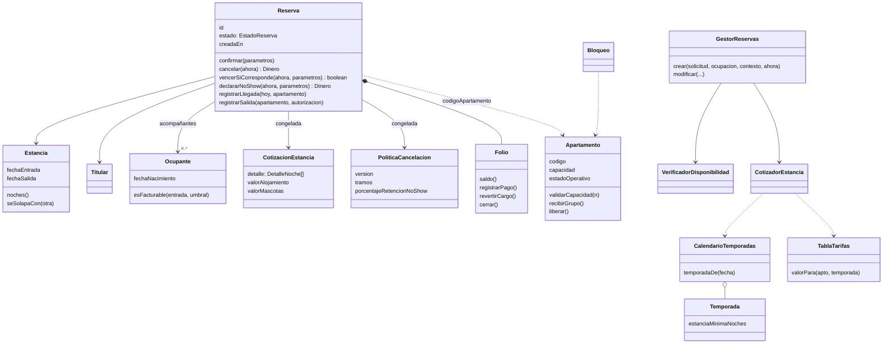
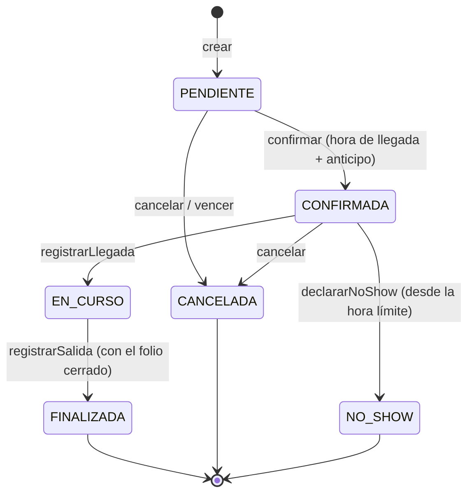
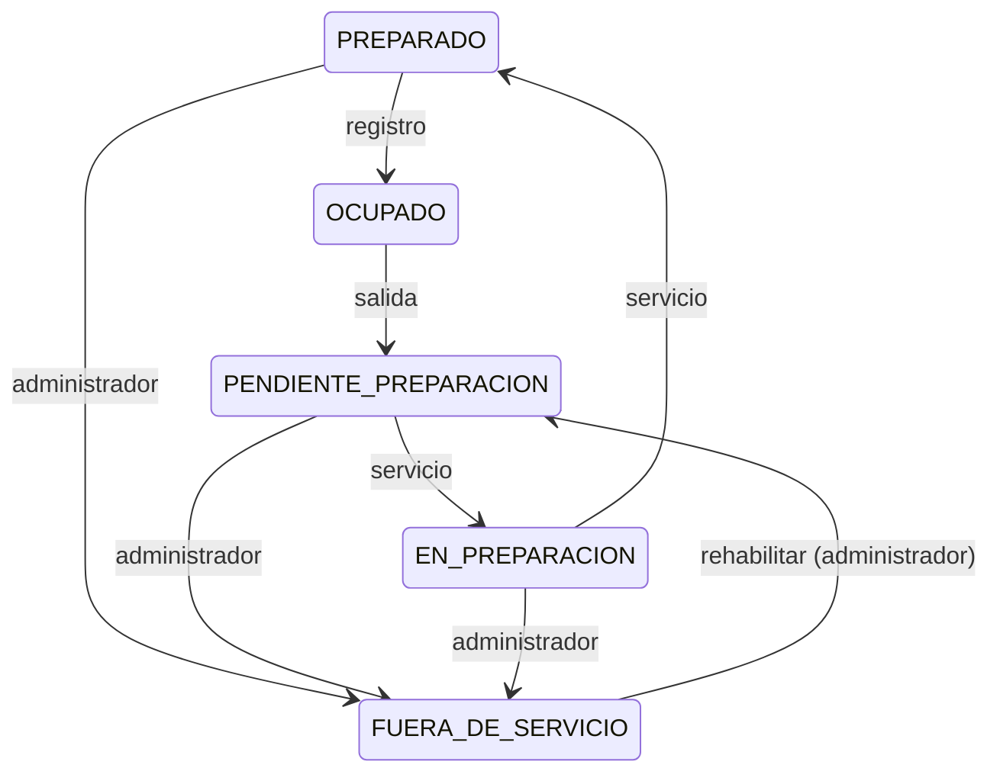

# Modelo del negocio — Dominio del SGA

El dominio vive en `co.edu.uniquindio.sga.domain` y es Java puro: no importa Spring, JPA, Jakarta ni Lombok. Toda regla de negocio se valida aquí. Los adaptadores (REST, persistencia) solo traducen.

## Paquetes

| Paquete | Contenido |
|---|---|
| `comun` | `Dinero` (BigDecimal en COP, redondeo explícito), `RangoFechas` `[inicio, fin)`, `Reloj` (puerto para "hoy"), `ExcepcionNegocio` y `CodigoError` |
| `alojamiento` | `ParametrosAlojamiento`: todos los valores configurables de la Ficha |
| `apartamento` | `Apartamento` (capacidad y estado operativo), `EstadoOperativo`, `Bloqueo` |
| `tarifa` | `Temporada`, `CalendarioTemporadas` (una base, sin solapamiento), `Tarifa`, `TablaTarifas` (con histórico) |
| `politica` | `PoliticaCancelacion` (inmutable y versionada), `TramoCancelacion` |
| `reserva` | `Reserva` (agregado raíz), `EstadoReserva`, `Estancia`, `Ocupante`, `Titular`, `Canal`, `CotizacionEstancia`, `CotizadorEstancia`, `VerificadorDisponibilidad`, `GestorReservas` |
| `folio` | `Folio`, `Cargo`, `Pago`, `MedioPago`, `TipoCargo`, `AutorizacionCierre` |
| `canal` | `CanalVenta`, `ProcesadorReservasExternas`, `ConflictoCanal`, `ResultadoReservaExterna`, `EventoCanal` (bitácora) |
| `usuario` | `Usuario`, `Rol`, `CodigoRecuperacion` (recuperación de contraseña de un solo uso) |
| `recordatorio` | `Recordatorio`, `TipoRecordatorio`, `PlanificadorRecordatorios` |
| `reporte` | `CalculadoraReportes`, `Periodo`, `Reportes` |

## Diagrama de clases

## Ciclo de vida de la reserva

## Estado operativo del apartamento

## Decisiones de diseño

- **Congelamiento (RN-22):** la reserva guarda su `CotizacionEstancia` y su `PoliticaCancelacion` como valores inmutables. Cambiar las tarifas o publicar una política nueva no las altera.
- **Folio de solo inserción (RN-16):** no hay métodos para editar o borrar. Las correcciones son reversos que referencian al movimiento original.
- **Cancelación, no-show y vencimiento:** se revierten los cargos vigentes y, si corresponde, se agrega una PENALIDAD por la retención. El saldo negativo resultante es la devolución, que se ejecuta fuera del sistema. El vencimiento no genera penalidad.
- **Salida:** requiere cerrar el folio. Si el saldo no es cero, hace falta una `AutorizacionCierre` con autor y motivo.
- **Tiempo de preparación (RN-20):** si la preparación no cabe entre la hora de salida y la hora de entrada, se rechazan las estancias que empiezan el día de salida de otra, o que terminan el día de entrada de otra.
- **Titular:** siempre es ocupante y debe ser facturable. El dominio no conoce "usuario".
- **Hoy:** el dominio recibe la fecha y hora como parámetro. El puerto `Reloj` las entrega en la zona America/Bogota desde la infraestructura, aunque el servidor esté en otra zona (Render usa UTC).
- **Medios de pago:** son valores de configuración (`MedioPago` es un objeto de valor, no un enumerado cerrado).

## Trazabilidad de reglas y pruebas

Todas las pruebas están en `src/test/java/co/edu/uniquindio/sga/domain`. Cada regla tiene al menos un caso que la cumple y uno que la viola.

| Regla | Dónde se valida | Pruebas |
|---|---|---|
| RN-01 | `VerificadorDisponibilidad`, `Estancia.seSolapaCon` | `CreacionReservaTest.Solapamiento`, `ComunTest.EstanciaYNoches` |
| RN-02 | `Apartamento.validarCapacidad` | `ApartamentoTest`, `CreacionReservaTest.Capacidad` |
| RN-03 | `RangoFechas` / `Estancia` | `ComunTest.EstanciaYNoches` |
| RN-04 | `VerificadorDisponibilidad` | `CreacionReservaTest.FechaEntrada` |
| RN-05 | `CotizadorEstancia` | `CotizadorEstanciaTest` |
| RN-06 | `Ocupante.esFacturable` | `CotizadorEstanciaTest`, `CreacionReservaTest.Capacidad` |
| RN-07 | `VerificadorDisponibilidad`, `Bloqueo.afecta` | `CreacionReservaTest.bloqueo*` |
| RN-08 | `EstadoReserva.validarTransicionA` | `EstadoReservaTest` (las 36 combinaciones) |
| RN-09 | `Reserva.confirmar` | `CicloDeVidaReservaTest.Confirmacion` |
| RN-10 | `Reserva.registrarLlegada` | `CicloDeVidaReservaTest.Registro` |
| RN-11 | `Apartamento.recibirGrupo` | `CicloDeVidaReservaTest.Registro`, `ApartamentoTest` |
| RN-12 | `EstadoReserva.esActiva` | `CicloDeVidaReservaTest.LiberacionDeNoches`, `CreacionReservaTest.Solapamiento` |
| RN-13 | `Reserva.cancelar` / `declararNoShow` con la política congelada | `CicloDeVidaReservaTest.Cancelacion`, `PoliticaCancelacionTest` |
| RN-14 | `GestorReservas.modificar` | `ModificacionReservaTest` |
| RN-15 | `Folio.registrarPago`, `Folio.saldo` | `FolioTest` |
| RN-16 | `Folio.revertirCargo` / `revertirPago` | `FolioTest` |
| RN-17 | `Folio.cerrar` / `cerrarConAutorizacion` | `FolioTest`, `CicloDeVidaReservaTest.Salida` |
| RN-18 | `ProcesadorReservasExternas` | `ProcesadorReservasExternasTest` |
| RN-19 | `ProcesadorReservasExternas` (y restricción única `uk_reserva_referencia_externa` en persistencia) | `ProcesadorReservasExternasTest` |
| RN-20 | `VerificadorDisponibilidad`, `ParametrosAlojamiento` | `CreacionReservaTest.TiempoPreparacion`, `ParametrosAlojamientoTest` |
| RN-21 | `Reserva.vencerSiCorresponde` (el disparo automático es `TareaVencimientoReservas`, cada minuto) | `CicloDeVidaReservaTest.Vencimiento` |
| RN-22 | `Reserva` (cotización y política congeladas) | `CicloDeVidaReservaTest.valorCongelado`, `ModificacionReservaTest` |
| RP-01 | `VerificadorDisponibilidad`, `Temporada.estanciaMinimaNoches` | `CreacionReservaTest.EstanciaMinima` |
| RP-02 | `CotizadorEstancia` | `CotizadorEstanciaTest` |
| RP-03 | `VerificadorDisponibilidad`, `CotizadorEstancia` | `CreacionReservaTest.Mascotas`, `CotizadorEstanciaTest` |
